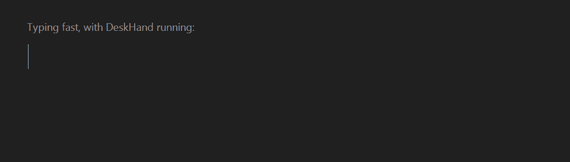
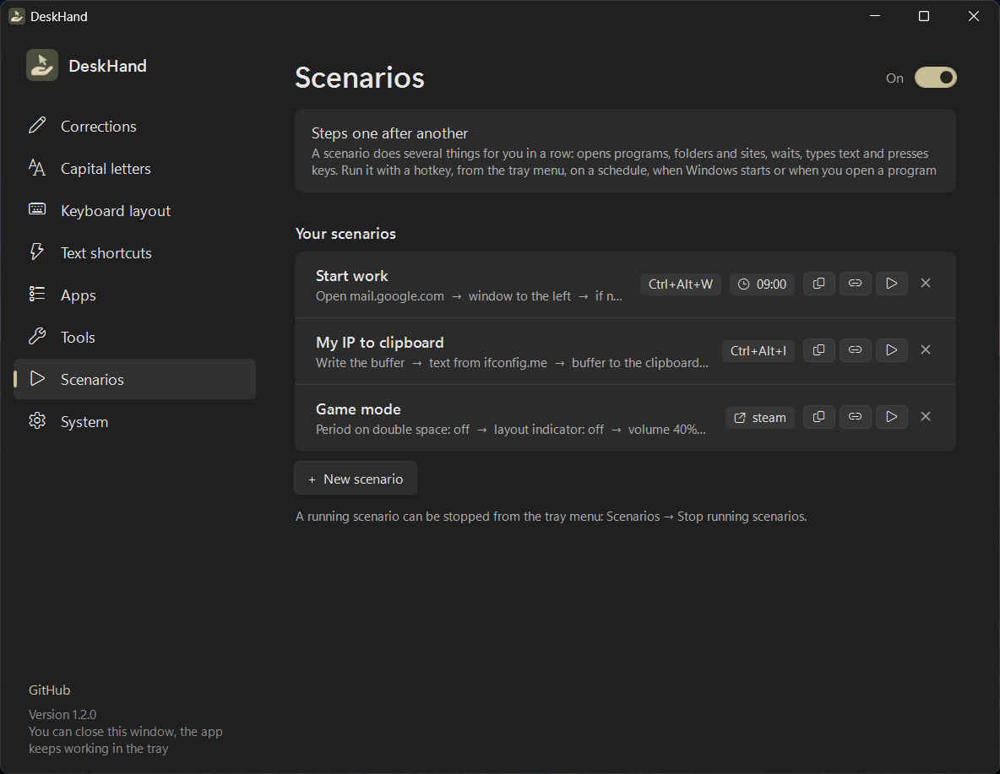
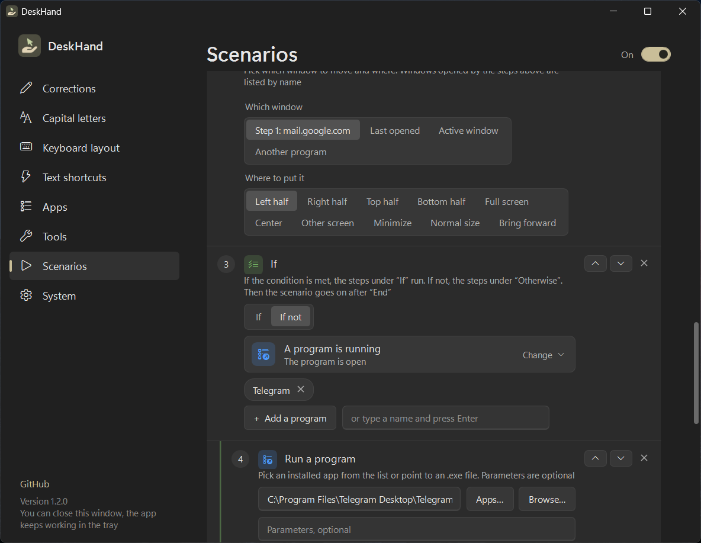
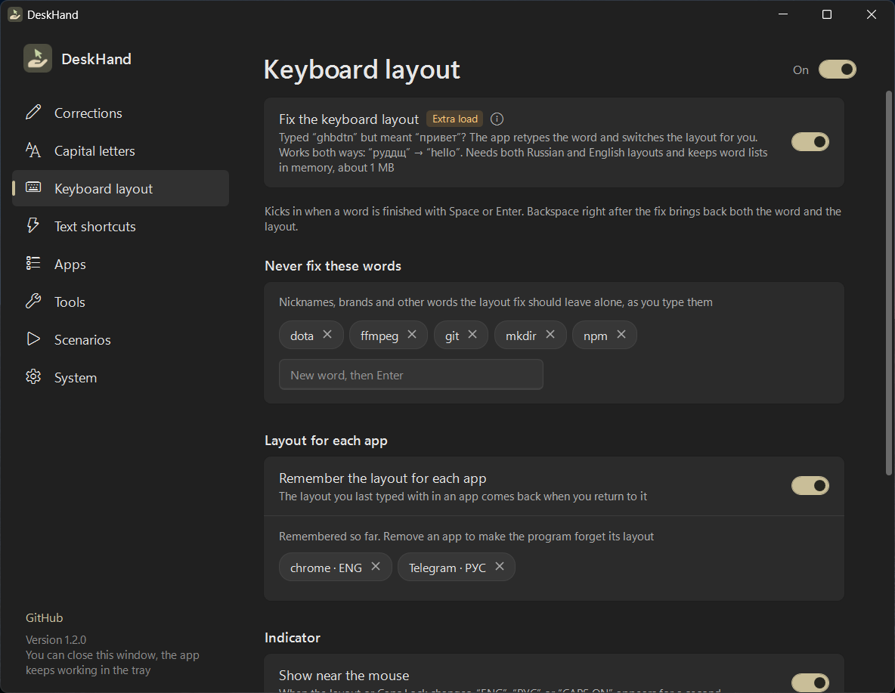
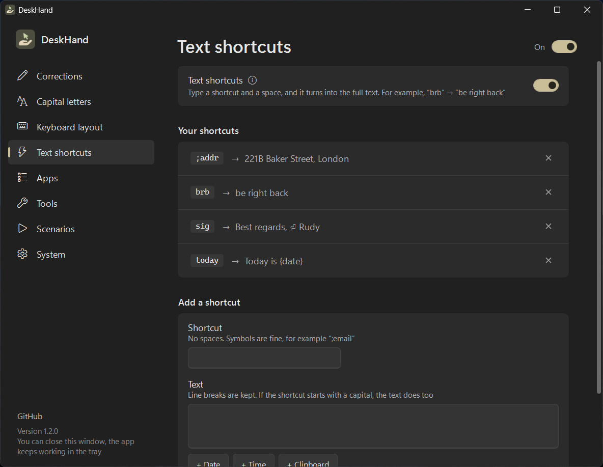
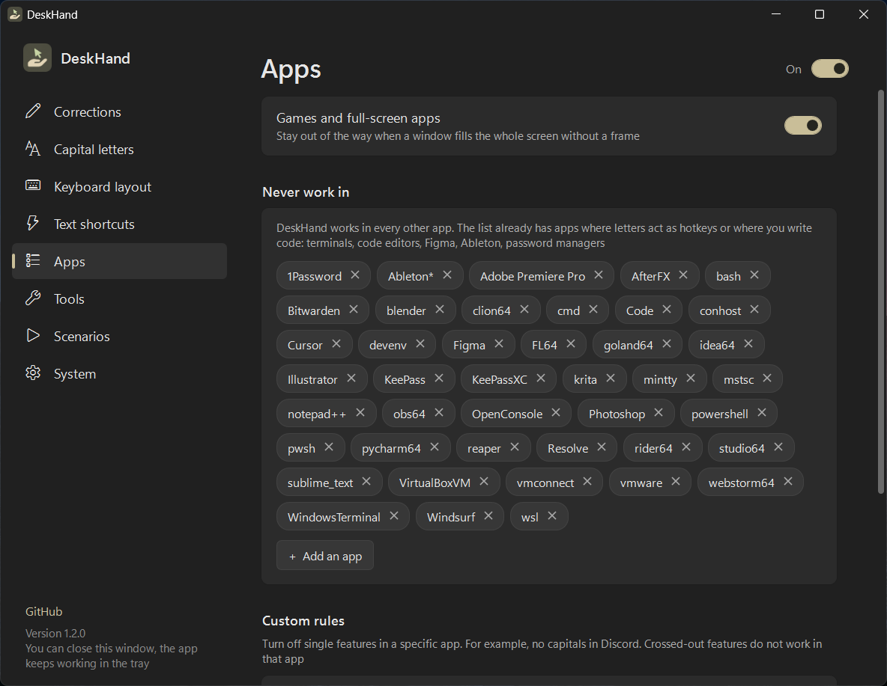
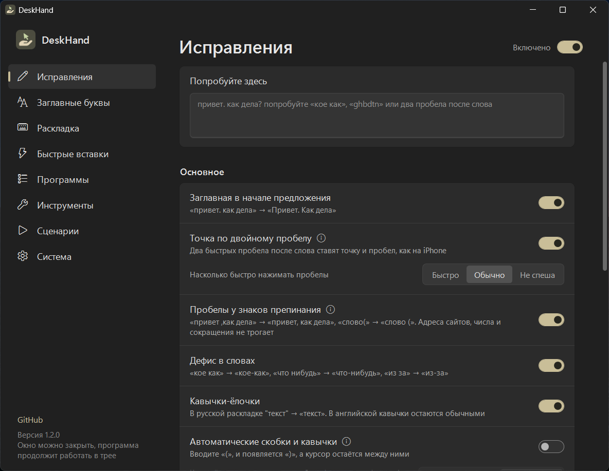
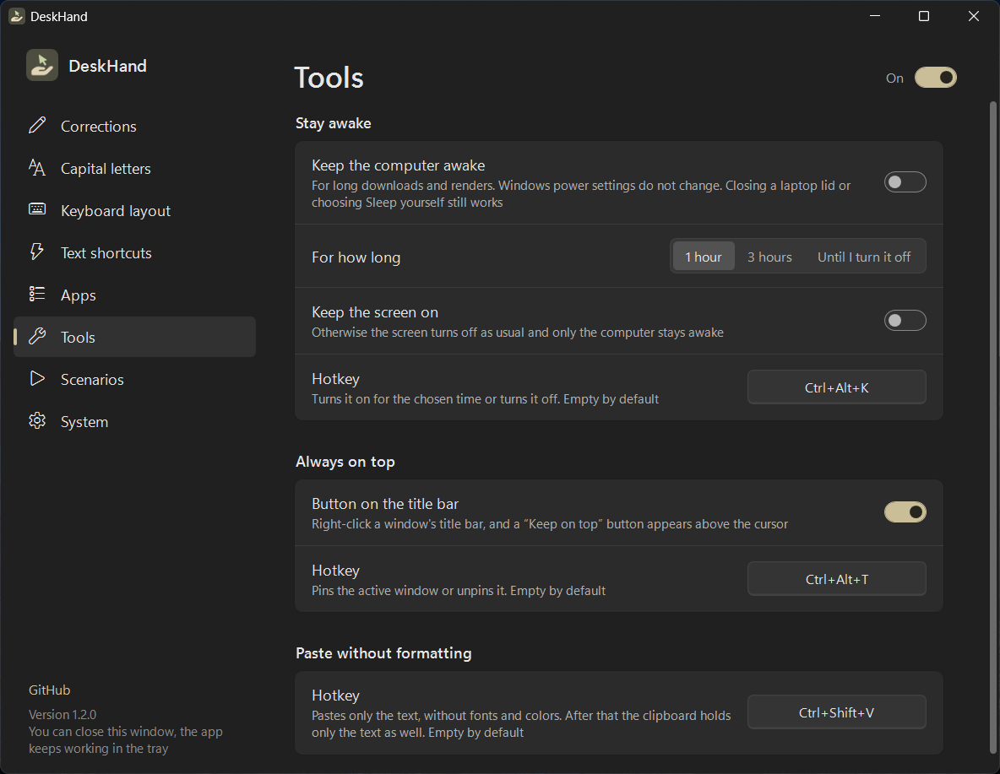
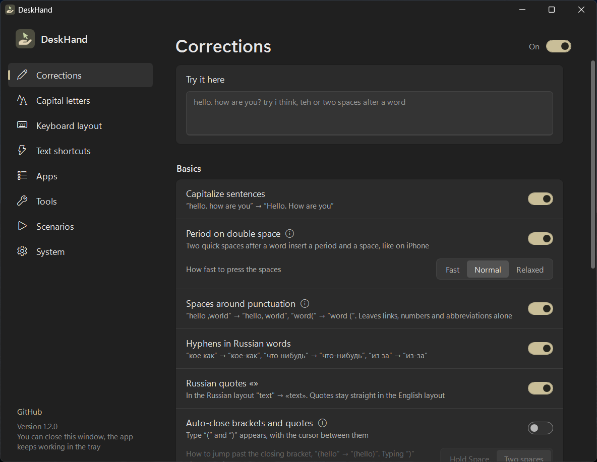

<p align="center">
  
</p>

<h1 align="center">DeskHand</h1>

<p align="center">
  <b>Fixes your text as you type and takes routine work off your hands in Windows: windows, programs, sites and scenarios on a hotkey or an event.</b><br>
  A tiny tray app. No installer, no telemetry.
</p>

<p align="center">
  <a href="../../releases/latest"></a>
</p>

<p align="center">
  
  
  
  <a href="README.ru.md"></a>
</p>

<p align="center">
  
</p>

## Why

Your phone fixes the small stuff while you type: the capital at the start of a sentence, the period after two spaces.
Windows 11 has the same options, but **only for the touch keyboard**. DeskHand brings them to a real keyboard,
in every app: browsers, messengers, Word, Notepad, Discord, Telegram and the rest.

And it does more than fix text. **Scenarios** take routine work off your hands: open your mail and messenger and put
them side by side with one key, mute the sound when you lock the computer, switch features off while a game is running.

## Features

| | What it does | Example |
|---|---|---|
| **Capitals** | Starts every sentence with a capital letter. Knows abbreviations, links and numbers | `hello. how are you` → `Hello. How are you` |
| **Double-space period** | Two quick spaces after a word insert a period and a space | `done␣␣next` → `done. Next` |
| **Punctuation spacing** | Removes the space before a comma, adds one after punctuation and before `(` | `hello ,world` → `hello, world` |
| **Accidental Caps Lock** | Fixes the word and turns Caps Lock off | `hELLO` → `Hello` |
| **Common typos** | A built-in list of frequent mistakes, plus your own corrections | `teh`, `definately` → `the`, `definitely` |
| **“I” in English** | Capitalizes the pronoun | `i think i'm right` → `I think I'm right` |
| **Wrong keyboard layout** | Retypes a word typed in the wrong layout and switches the layout for you (Russian ⇄ English) | `ghbdtn` → `привет`, `руддщ` → `hello` |
| **Auto brackets** | Off by default. Closes brackets and quotes for you. To jump past the closing one, hold Space for a moment or press it twice, you choose | `(hello` + hold <kbd>Space</kbd> → `(hello)` |
| **Text shortcuts** | Your own abbreviations that expand into text, with line breaks. The text can include `{date}`, `{time}` and `{clipboard}` | `brb` → `be right back` |
| **Layout for each app** | Off by default. Remembers the layout you typed with in every app and brings it back | Telegram in Russian, browser in English |
| **Layout indicator** | Shows the layout or Caps Lock next to the mouse for a second when it changes. Three sizes | `ENG`, `РУС`, `CAPS ON` |
| **Always on top** | Keep any window above the others: a button on right-click of the title bar, or your own hotkey | |
| **Paste without formatting** | Pastes clean text with your own hotkey, no fonts or colors | |
| **Stay awake** | Keeps the computer from sleeping for 1 hour, 3 hours or until you turn it off. From the tray menu, the settings or your own hotkey | |
| **Per-app rules** | Turn off single features in a specific app, or leave an app alone completely | no capitals in Discord |
| **Scenarios** | Several actions in a row by a hotkey, from the tray menu, on a schedule, when Windows starts, when you open or close a program, when you leave the computer, when a device connects, Wi-Fi changes, the charger is plugged in and on other events. Steps: open a site, a program, a folder or a file, arrange windows, click the mouse, run a command, type text, press keys, take text from a site, build text in the scenario buffer, change the volume, “if / otherwise” blocks, repeat and more | open your work folder and mail with one key |
| **Pause hotkey** | Pause and resume from anywhere. You can change the combination or remove it | <kbd>Ctrl</kbd>+<kbd>Alt</kbd>+<kbd>B</kbd> |
| **Russian extras** | Hyphens and «guillemets» for Russian text | `кое как`, `какието` → `кое-как`, `какие-то`, `"текст"` → `«текст»` |

**Every correction can be undone:** press <kbd>Backspace</kbd> right after it and you get exactly what you typed.

It is careful by design:

- Before capitalizing after a click, it reads the text in front of the cursor (the same way Windows Narrator does), so it never capitalizes in the middle of a sentence.
- It does nothing in password fields, games and full-screen apps, and in code editors, terminals and password managers by default.
- The layout fix only works when both Russian and English layouts are installed. Tested on the 20,000 most frequent words: under 0.05% false positives.

## Scenarios

A scenario is a list of steps that DeskHand runs for you, one after another.

**When it runs:** on a hotkey, from the tray menu, from a desktop shortcut, on a schedule, when Windows starts,
when you open or close a program, when you step away from the computer or come back, and on system events:
a device or headphones connected, Wi-Fi changed, the charger plugged in, the computer locked or woken up, a screen connected.
A scenario can ask before it runs.

**What it can do:**

- open a site, a program (including Microsoft Store apps), a folder or a file, and wait until its window appears;
- arrange windows: left or right half, full screen, another screen; wait for a window or for a program to close; close a program, a window or a tab;
- click the mouse at a recorded spot that follows the window when it moves or changes size;
- type text, press key combinations, copy text to the clipboard;
- take text from a web page and build your own text in the scenario buffer;
- change the volume or the track, lock the computer, turn off the screen, sleep, shut down;
- turn any DeskHand feature on or off;
- “If / Otherwise” blocks and repeats with conditions: a program is running, the time of day, the day of the week, Wi-Fi, internet, battery, a device, the sound output, the number of screens, text in the clipboard.

<p align="center">
  
  
</p>

## Install

1. Download **`DeskHand.exe`** from [Releases](../../releases/latest) and put it in any folder.
2. Run it. The settings window opens and the icon appears in the tray.
3. In **System**, turn on **Start with Windows**. Done. You can close the window, the app keeps working in the tray.

Settings are saved to `%APPDATA%\DeskHand\DeskHand.ini`, so a new version keeps them: download it, run it, and everything is in place. Before a new version changes the file, it saves a copy next to it, for example `DeskHand.ini.v1.bak`. A settings file left next to an older exe moves there on its own. The app used to be called BetterWriting: DeskHand takes over its settings and autostart and closes a running BetterWriting so the two do not work at the same time.
The interface is in English by default; switch to Russian in **System → Language**. The theme is dark by default; switch it in **System → Theme**.

> [!NOTE]
> DeskHand watches the keyboard to do its job, and the app is not code-signed. Windows SmartScreen may warn
> you on the first run (**More info → Run anyway**), and Microsoft Defender sometimes flags such apps with a
> machine-learning guess like `Trojan:Win32/Bearfoos.A!ml`. The app never writes down or sends what you type,
> and the full source is here: you can read it and [build it yourself](#build-from-source) in one command.

## Using it

- **Left-click** the tray icon to open the settings. Running `DeskHand.exe` again does the same.
- **Right-click** for a quick menu: pause (the icon turns grey), “Don't work in this app”, “Stay awake”, your scenarios, exit.
- Press <kbd>Ctrl</kbd>+<kbd>Alt</kbd>+<kbd>B</kbd> to pause or resume from anywhere.
- Use the **Try it here** box at the top of the settings to see the corrections live, and hover the **ⓘ** icon next to a feature to watch a short animation of it.

<p align="center">
  
  
</p>
<p align="center">
  
  
</p>
<p align="center">
  
  
</p>

## Performance and privacy

- **Idle:** about 0% CPU. It wakes up on a key press or a click, and every 10 seconds for a quick check that Windows has not disconnected its keyboard hook. If it has, the app reconnects on its own.
- **Memory:** about 9 MB in the background. The settings window runs as a separate process and frees its memory when closed.
- **The app does not go online on its own.** Only when you add a “Take text from a site” step to a scenario, and only to the site you set. Nothing is logged or stored except your settings file.
- Two features do a bit of extra work and are marked **Extra load** in the settings: reading the text before the
  cursor after a click or a window switch, and the layout fix (word lists take about 1 MB of memory).

## Limitations

- Windows does not let regular apps touch windows that run **as administrator**, so DeskHand does not work there.
- In Chromium-based apps (Chrome, Edge, Discord, Electron apps) reading the text before the cursor turns on their
  accessibility support. It is unnoticeable on normal pages.
- The layout fix knows the standard US QWERTY and Russian ЙЦУКЕН layouts.
- “Take text from a site” reads ordinary pages. Sites that build the page with scripts or block bots will not work.
- Scenarios cannot click or type in windows that run as administrator, for the same reason as above.
- Built and tested on Windows 11. Windows 10 should work but is not tested.

## Build from source

Nothing to install: the C# compiler ships with Windows (.NET Framework 4.8).

```bat
build.cmd
```

`DeskHand.exe` appears next to `build.cmd`. Run the logic tests (typing scenarios) with:

```bat
tests\run.cmd
```

<details>
<summary>Project structure</summary>

| Path | What it is |
|---|---|
| `src/Engine.cs` | All correction logic and undo. No Windows API, covered by tests |
| `src/Hooks.cs` | Global keyboard and mouse hooks, layout and Caps Lock handling, sending replacements, per-app rules |
| `src/ContextReader.cs` | Reads the text before the cursor through UI Automation on a background thread |
| `src/Dictionaries.cs` | Word lists for the layout fix, stored as 64-bit hashes |
| `src/Program.cs` | Tray icon, menu, autostart, single instance, moving over from BetterWriting, talking to the settings window |
| `src/SettingsWindow.cs`, `src/Settings.xaml` | The settings window (WPF, light and dark theme) |
| `src/Config.cs` | Reading and writing `DeskHand.ini`, the scenario model, conditions and page text parsing |
| `src/ScenarioRunner.cs`, `src/ScenarioExtras.cs` | Running scenario steps |
| `src/Triggers.cs` | Scenario triggers: schedule, programs, idle time, system events; the “Run the scenario?” window |
| `src/SystemState.cs` | Devices, Wi-Fi, internet, battery, sound output |
| `src/SettingsScenarios.cs`, `src/ClickRecorder.cs`, `src/AppList.cs` | The scenario editor, click recording, the list of installed apps |
| `src/Toggles.cs` | Names of the settings a scenario can switch |
| `src/Hotkey.cs` | Parsing and formatting hotkeys |
| `src/WindowTools.cs` | Layout indicator, always on top and its title-bar button |
| `src/hints/` | Short animations shown in the settings window |
| `src/Loc.cs` | English and Russian interface strings |
| `src/dict/` | Compressed word lists |
| `tests/` | Logic tests |
| `tools/make-icons.ps1` | Builds the icons and `assets/logo.png` from `assets/logo-source.png` |
| `tools/make-dicts.ps1` | Builds the word lists from FrequencyWords |

</details>

## License

[MIT](LICENSE) © 2026 Rudy Eastwick.

Word lists are derived from [FrequencyWords](https://github.com/hermitdave/FrequencyWords) (CC BY-SA 4.0),
see [THIRD-PARTY-NOTICES.md](THIRD-PARTY-NOTICES.md).
